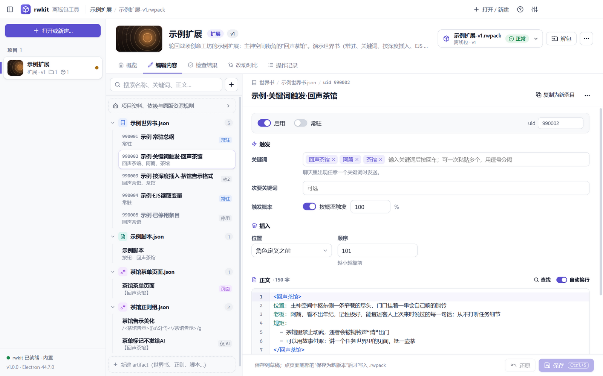
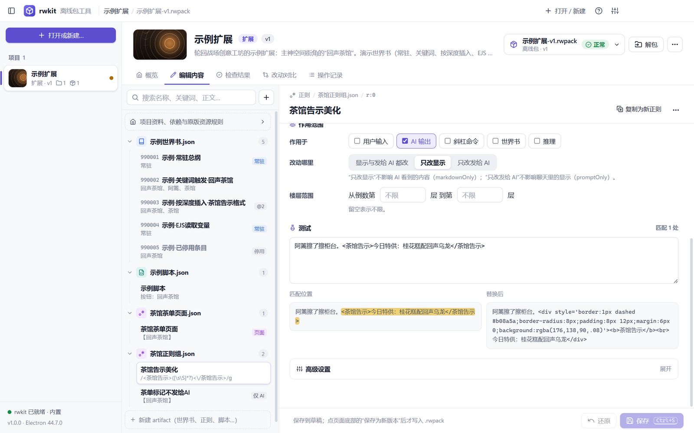
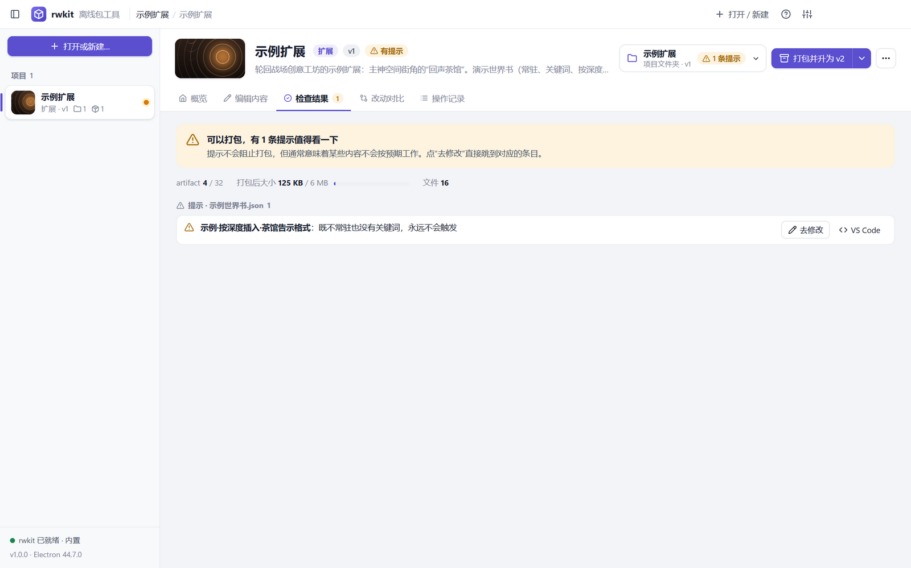
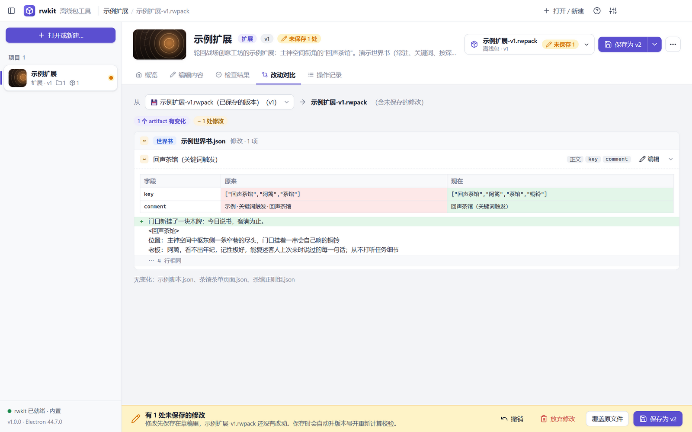
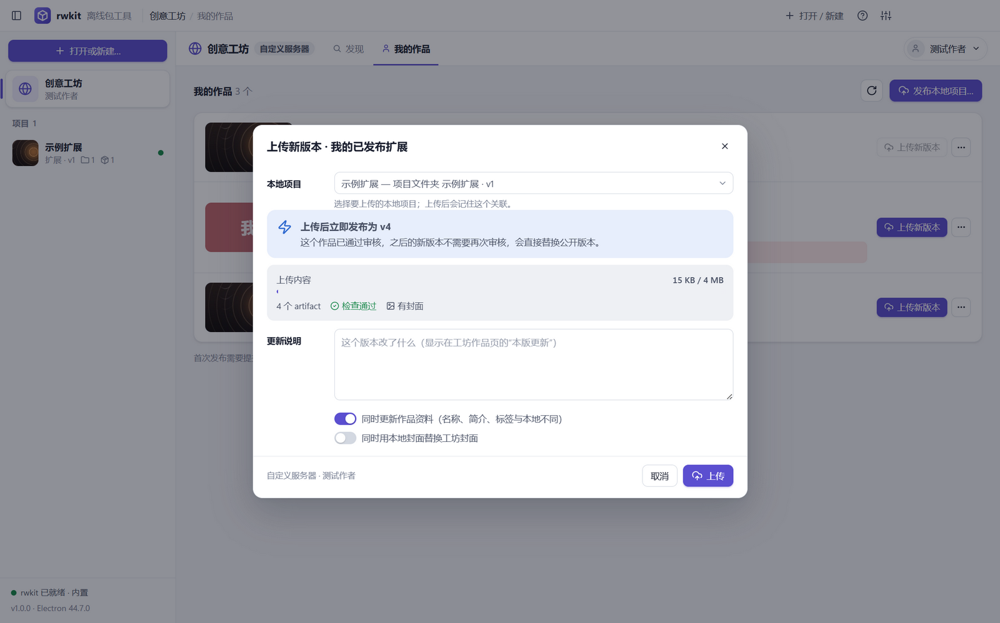
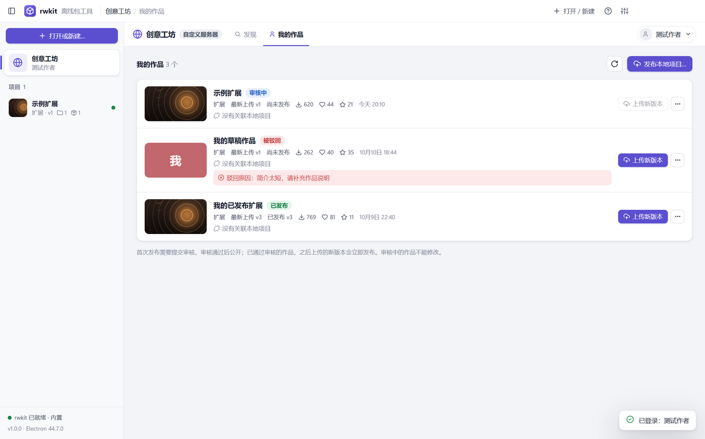
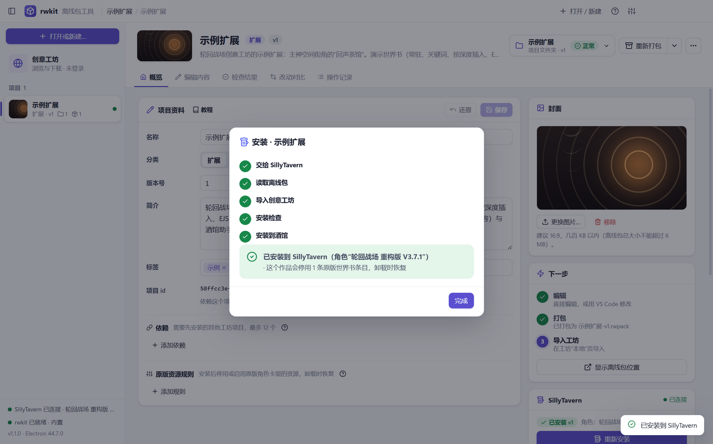
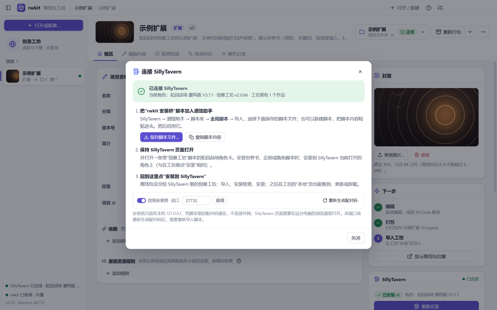
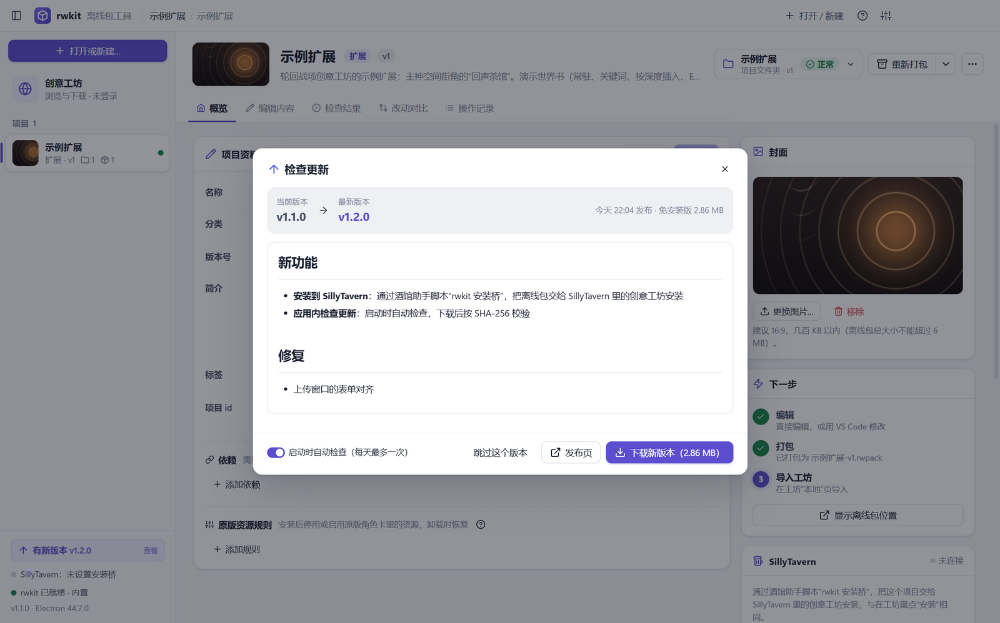
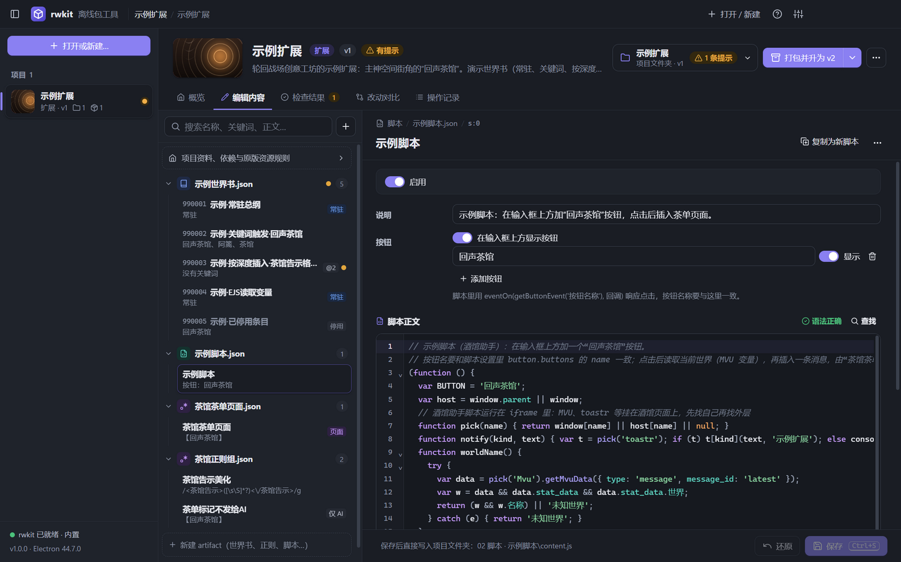

<div align="center">


# rwkit 离线包工具

**轮回战场创意工坊离线包（`.rwpack`）的桌面编辑器**

检查 · 修复 · 直接编辑 · 解包 · 打包 · 创意工坊下载与发布 · 安装到 SillyTavern —— 与 rwkit 命令行同一套校验规则

[](https://github.com/demogest/rwkit-desktop/releases/latest)


[](LICENSE)

[下载](#下载) · [功能](#功能) · [创意工坊](#创意工坊在线) · [安装到 SillyTavern](#安装到-sillytavern) · [**扩展编写教程**](docs/扩展编写教程.md) · [使用指南](#使用指南) · [从源码构建](#从源码构建) · [常见问题](#常见问题)


</div>

## 这是什么

轮回战场（SillyTavern 角色卡）的创意工坊可以导入**离线包**（`.rwpack`）：一个 JSON 文件，里面装着世界书、正则、酒馆助手脚本、预设等内容，以及大小、SHA-256 等校验清单。手动改过离线包之后，校验对不上，工坊就会拒绝导入。

rwpack 工具包里的 `rwkit.mjs` 是处理离线包的命令行工具（修复、检查、解包、打包、生成示例）。**rwkit 离线包工具**是它的桌面版：

- **所有检查与写包都直接调用 `rwkit.mjs`**（不改动它），结果与 `node rwkit.mjs …` 完全一致——这里说没问题的包，工坊就能导入和安装。
- 在此之上提供**直接编辑**：打开 `.rwpack` 就能改世界书条目、正则、脚本和项目资料，保存时自动升版本号、重算校验，不需要再手动解包、改文件、打包。
- 并连接**创意工坊**：浏览和下载工坊作品；用 Discord 登录后，把本地项目发布到工坊、上传新版本、提交审核。
- 还能**直接安装到 SillyTavern**：交给 SillyTavern 里的创意工坊安装，改完立刻在酒馆里试。

## 下载

在 [Releases](https://github.com/demogest/rwkit-desktop/releases/latest) 页面下载：

| 文件 | 说明 |
| --- | --- |
| `rwkit-desktop-版本-setup.exe` | **安装版**：创建开始菜单与桌面快捷方式，关联 `.rwpack`（双击离线包直接打开），启动更快 |
| `rwkit-desktop-版本-portable.exe` | **免安装单文件**：放在哪里都能运行，适合放进工具包文件夹或发给别人 |

- 系统：Windows 10 / 11（64 位）。Node.js 已内置，不需要另外安装。
- 程序没有代码签名，第一次运行时 Windows 可能提示“已保护你的电脑”：点“更多信息”→“仍要运行”。
- 之后的新版本可以在程序里更新：启动时自动检查（每天最多一次，可以关闭），也可以点右上角“?”→“检查更新”。安装版下载后运行安装程序，免安装版把新版本下载到当前 exe 旁边；下载的文件按 GitHub 提供的 SHA-256 校验。

## 功能

### 直接编辑



左侧按 artifact 列出全部内容，可以搜索名称、关键词、正文；右侧是对应的表单。正文与代码用 [CodeMirror](https://codemirror.net/) 编辑：语法高亮、行号、折叠、查找替换（<kbd>Ctrl</kbd>+<kbd>F</kbd>）。

| 内容 | 可以编辑 |
| --- | --- |
| **世界书条目** | 名称、启用、常驻、uid；关键词与次要关键词（标签式输入，可一次粘贴多个）及逻辑；触发概率；插入位置、深度、身份、顺序；正文（高亮 EJS `<% %>`、`<标签>`、`{{宏}}`）；递归、分组、粘性 / 冷却 / 延迟等高级设置 |
| **正则** | 名称、启用、查找（实时判断能否编译）、替换为（HTML 页面自动识别并高亮，可在沙箱里预览）、作用于、改动哪里（显示 / 发给 AI）、楼层范围、裁剪文字、查找中的宏；**测试区**实时显示匹配位置与替换结果 |
| **酒馆助手脚本** | 名称、启用、说明、输入框上方的按钮；脚本正文（JavaScript 高亮，**实时语法检查**，出错时点提示跳到对应行） |
| **预设 / 数据** | JSON 编辑，实时校验格式 |
| **artifact 设置** | 名称、脚本作用域、原版冲突声明（停用 / 替换原版条目或脚本）、调整顺序、删除 |
| **项目资料** | 名称、分类、版本号、简介、标签、封面（选择或直接拖入图片）、依赖、原版资源规则 |

还可以新建条目 / 正则 / 脚本、复制为新的一项、新建 artifact（世界书、正则、脚本、预设、数据），以及从零新建项目。



### 两种编辑方式

| | 直接编辑离线包 | 编辑项目文件夹 |
| --- | --- | --- |
| 打开 | `.rwpack` | 解包得到的文件夹（含 `project.json`） |
| 保存条目时 | 写进**草稿**（内存中），离线包本身不变；可以逐步撤销或全部放弃 | 立即写回对应的文件：条目 `.txt`、`artifact.json`、引用的 `.html` / `.js` |
| 生成离线包 | 点“**保存为新版本**”：版本号 +1、重算校验，另存为 `名称-v新版本.rwpack`，原文件不动（也可以选择覆盖原文件） | 点“**打包**”（可同时升版本号并写回 `project.json`） |
| 适合 | 改几条设定、修个正则 | 大量修改、与 VS Code 混用 |

编辑项目文件夹时，只改动需要改的文件，原来引用的文件仍写在原处，新加的长文本按 rwkit 解包的习惯拆成单独文件；在 VS Code 里保存的修改约 1.5 秒内自动重新检查。删除的条目与 artifact 移到回收站。

### 检查结果



打开时自动检查，保存后重新检查：导入格式、安装检查（条目缺名称、正则缺查找、脚本为空等）、大小与 SHA-256、6 MB 上限，以及 rwkit 的常见问题提示（条目永远不会触发、EJS 标签不配对、正则页面会被酒馆改写……）。每条提示都可以点“**去修改**”直接跳到对应条目；项目文件夹里的 JSON 写坏时会指出文件与行号，点一下用 VS Code 打开到那一行。

手动改过、导入时报“大小校验失败 / SHA-256 校验失败”的离线包，点“**修复**”即可（原文件另存为 `.bak`）。

### 改动对比



比较任意两个版本（离线包、项目文件夹，或草稿与已保存的版本）：精确到每条世界书、每条正则、每个脚本的字段变化，正文逐行对比并标出行内差异。保存前可以先确认改了什么。

### 创意工坊（在线）


左侧的“**创意工坊**”连接轮回战场创意工坊的服务器（与酒馆里“创意工坊”脚本是同一个服务，接口与[官方客户端](https://github.com/Unspoken-MomoTea/Battlefield-of-Reincarnation/tree/main/src/CreativeWorkshop)一致）：

| | 不登录 | 用 Discord 登录后 |
| --- | --- | --- |
| **发现** | 按分类（扩展 / 开局商店 / 世界书角色 / 开局角色 / 开局伙伴 / 异端库）、关键词、标签浏览，按最新、热门、下载、点赞、收藏排序；作品页显示简介、本版更新、内容清单（世界书条目、正则、脚本）、依赖与版本历史 | 点赞、收藏 |
| **下载** | “下载并打开”：生成 `.rwpack` 离线包（与工坊“本地”页导出的格式相同，按清单校验 SHA-256，嵌入封面），直接在程序里查看、修改、再导入工坊。下载不会执行其中的脚本 | 自己的作品还可以下载最新上传、尚未发布的版本 |
| **更新提醒** | 打开的项目在工坊上有更新的版本时，项目列表里显示 ↑ 标记，概览页一键下载新版本 | |
| **发布** | | 把本地项目（离线包或项目文件夹）发布为新作品：填写名称、分类、简介、标签，上传内容与封面，提交审核 |
| **上传新版本** | | 为自己的作品上传新版本：可以同时把名称、简介、标签、依赖同步为本地的内容，替换封面；首次发布需要审核，已通过审核的作品之后上传的版本会立即发布 |
| **我的作品** | | 查看状态（草稿 / 审核中 / 已发布 / 被驳回及原因）、提交审核、编辑资料、更换封面、下架 / 重新上架、永久删除 |



- **登录**：在系统浏览器里打开 Discord 授权页，授权后回到程序自动完成登录（与工坊客户端的“打开授权页”方式相同，只读取 Discord 用户名与头像）。登录凭据用 Windows 系统加密（DPAPI）保存在本机。
- **本地项目与工坊作品的关联**：工坊下载的离线包与作品 id 相同，自动关联；自己新建的项目发布或上传一次后会记住关联，之后在概览页的“创意工坊”卡片里直接“上传为新版本”。
- **上传前检查**：有未保存的草稿、有会让工坊安装失败的错误、内容超过 4 MB、封面不是 PNG / JPEG / WebP 或超过 3 MB 时，在本地就会拦下并说明原因。
- **服务器**：默认连接正式服；设置 → 创意工坊里可以切换到测试服或自定义地址，并修改下载位置。每个服务器分别保存登录状态。



### 安装到 SillyTavern



改完的离线包或项目文件夹，可以直接装进 SillyTavern 试用，不需要再到工坊的“本地”页手动导入。安装由 SillyTavern 里的**轮回战场创意工坊自己完成**（导入 → 安装检查 → 安装），与在工坊里点“安装”完全相同：世界书合并进“轮回战场·创意工坊”并绑定到当前角色、正则与脚本按作用域安装、原版资源规则与冲突声明、开局角色 / 伙伴 / 商店数据都照常处理，之后也能在工坊“本地”页更新或卸载。

1. 设置 → SillyTavern → **连接设置**，点“保存脚本文件…”。
2. 在 SillyTavern 里打开 酒馆助手 → 脚本库 → **全局脚本** → 导入这个文件（或新建脚本粘贴“复制脚本内容”），启用。
3. 保持 SillyTavern 页面打开，并打开一张带“创意工坊”脚本的轮回战场角色卡。左下角显示“SillyTavern 已连接 · 角色名”。
4. 在项目概览页的“**SillyTavern**”卡片、版本菜单或工坊作品页（“下载并安装到 SillyTavern”）点安装。



- 已经安装过的作品会先卸载旧版本再安装新版本；工坊里缓存了更高的版本时，需要先提高本地项目的版本号（工坊不会用旧离线包覆盖新版本）。
- 卸载也可以在这里点“从酒馆卸载”，同样交给工坊完成，会恢复它改动过的原版内容。
- 有未保存草稿或检查出错误的项目不能安装，与上传工坊的要求相同。
- “rwkit 安装桥”只在本机 `127.0.0.1:27720`（端口可改）监听，凭脚本里的随机配对码通信；需要在**这台电脑的浏览器**里打开 SillyTavern。

### 检查更新



启动时自动查询 GitHub 上的最新发布（每天最多一次，可以关闭），有新版本时左下角会提示；也可以随时点右上角“?”→“检查更新…”。更新窗口里显示更新说明，下载对应的安装版或免安装版并按 SHA-256 校验，然后一键安装或运行新版本；可以跳过某个版本。

### 其他

- **同一项目自动归组**：打开一个离线包或项目文件夹时，会找出同一文件夹里同一项目（`project.id` 相同）的其他版本和解包文件夹，放在一起切换。
- **下一步提示**：按“编辑 → 保存 / 打包 → 导入工坊”提示当前该做什么。
- **拖放**：把 `.rwpack`、项目文件夹或装着它们的文件夹拖进窗口即可打开；图片拖到封面区域直接设为封面。
- **单实例**：程序已打开时再双击 `.rwpack`，会在已有窗口里打开。
- **关闭保护**：有未保存的修改时，关闭窗口前会提醒。
- **深色模式**：跟随系统，也可以在设置里固定为浅色或深色。



## 扩展编写教程

第一次写扩展？请看 **[扩展编写教程](docs/扩展编写教程.md)**。它覆盖工坊支持的全部内容：

| 章节 | 内容 |
| --- | --- |
| [先认识离线包](docs/扩展编写教程.md#basics) | 离线包结构、五种 artifact、项目文件夹格式、工坊的硬性限制 |
| [快速上手](docs/扩展编写教程.md#quickstart) | 从示例扩展“回声茶馆”改出第一个扩展 |
| [项目资料](docs/扩展编写教程.md#project) | id、分类、版本号规则、简介、标签、封面 |
| [世界书](docs/扩展编写教程.md#worldbook) | 常驻 / 关键词 / 次要关键词、插入位置与深度、EJS、uid 规则、递归与分组 |
| [正则](docs/扩展编写教程.md#regex) | 字段、文字美化、只改发给 AI、**HTML 页面**的写法与会被酒馆改写的坑 |
| [酒馆助手脚本](docs/扩展编写教程.md#script) | 作用域、脚本与文件夹、按钮事件、与正则 / 世界书配合 |
| [预设](docs/扩展编写教程.md#preset) · [数据](docs/扩展编写教程.md#data) | 预设对象、交给本体读取的数据 |
| [原版资源规则](docs/扩展编写教程.md#overrides) · [原版冲突声明](docs/扩展编写教程.md#conflicts) · [依赖](docs/扩展编写教程.md#deps) | 停用 / 启用原版资源、声明冲突、依赖其他项目 |
| [检查、打包与发布](docs/扩展编写教程.md#check) | 错误 / 需修复 / 提示三级检查的全部规则、版本号、发布前自查 |
| [常见问题与排错](docs/扩展编写教程.md#faq) · [字段速查](docs/扩展编写教程.md#fields) | 常见报错的处理、各类内容的字段表 |

程序里也能离线查看：按 <kbd>F1</kbd>，或点右上角“?”→“扩展编写教程”；每个编辑表单右上角的“**教程**”按钮会直接跳到对应章节。

## 使用指南

### 快速开始

1. **打开**：把 `.rwpack` 拖进窗口，或点左上角“打开 / 新建”。
2. **编辑**：切到“编辑内容”页，在左侧选一项，修改后按 <kbd>Ctrl</kbd>+<kbd>S</kbd> 保存（离线包保存到草稿）。
3. **保存为新版本**：底部提示栏点“保存为 vN”，得到 `名称-vN.rwpack`。
4. **导入工坊**：在工坊“本地”页导入新包。已安装的同一版本不能直接覆盖导入，所以改包后要升版本号（“保存为新版本”会自动做）。

没有现成的离线包？点“打开 / 新建”→“新建项目…”，或“生成示例扩展…”得到一个覆盖常见写法的示例（“回声茶馆”）。

### 状态

| 标记 | 含义 |
| --- | --- |
| 正常 | 工坊可以导入和安装 |
| 有提示 | 能导入，但某些内容可能不会按预期工作（例如条目永远不会触发） |
| 需修复 | 校验信息与内容不一致，点“修复” |
| 有错误 | 格式不对或工坊安装会失败，需要改正 |
| 未保存 | 离线包有还没写入文件的修改（草稿） |

### 快捷键

| 按键 | 作用 |
| --- | --- |
| <kbd>Ctrl</kbd>+<kbd>S</kbd> | 保存当前编辑的条目 / 项目资料 |
| <kbd>Ctrl</kbd>+<kbd>F</kbd> | 在正文 / 代码里查找替换 |
| <kbd>Ctrl</kbd>+<kbd>O</kbd> / <kbd>Ctrl</kbd>+<kbd>Shift</kbd>+<kbd>O</kbd> | 打开离线包 / 项目文件夹 |
| <kbd>Ctrl</kbd>+<kbd>N</kbd> | 新建项目 |
| <kbd>Ctrl</kbd>+<kbd>1</kbd> … <kbd>5</kbd> | 切换页签：概览、编辑内容、检查结果、改动对比、操作记录 |
| <kbd>Ctrl</kbd>+<kbd>B</kbd> | 显示 / 隐藏项目列表 |
| <kbd>F5</kbd> | 重新检查当前版本 |

### 工坊的限制

离线包不超过 6 MB；artifact 最多 32 个；单个世界书最多 500 条；依赖最多 12 个；原版资源规则最多 300 条。超出时检查结果会直接指出。

## rwkit.mjs

所有校验、修复、解包与打包都由 `rwkit.mjs` 完成，本程序启动时按下面的顺序找第一个存在的：

1. 设置里选择的 `rwkit.mjs`（设置 → rwkit.mjs → 选择…）
2. 程序旁边的 `rwkit.mjs`（免安装版放在 exe 同一文件夹即可）
3. 内置版本（[`resources/rwkit.mjs`](resources/rwkit.mjs)）

工具包更新后，用上面任一方式换上新的 `rwkit.mjs` 就能生效，不需要重新下载程序；当前使用的是哪一个，在设置和左下角都能看到。

载入时会去掉命令行入口、导出内部函数，`rwkit.mjs` 文件本身不被修改；它不兼容（缺少需要的函数）时会明确提示。直接编辑另外用到 `entryText`、`Writer` 等函数，缺少时只有编辑功能不可用。

## 数据与隐私

- 离线包的检查、编辑、打包完全在本机进行，不收集任何数据。
- 联网只在两种情况：使用“创意工坊”，以及“检查更新”。创意工坊连接设置里的工坊服务器（默认 `https://workshop.6661816.xyz`），登录时由系统浏览器打开 Discord 授权页；工坊作品的封面缩略图从同一服务器读取，登录后的 Discord 头像从 Discord 的图片服务器（cdn.discordapp.com）读取。
- “检查更新”默认开启：启动时向 GitHub（`api.github.com`）查询本程序的最新发布，每天最多一次；在更新窗口里可以关闭。
- “安装到 SillyTavern”的安装桥只监听本机 `127.0.0.1`，不连接外网；启用后才监听，配对码保存在 `%APPDATA%\rwkit-desktop\tavern-bridge.json`。
- “更新提醒”默认开启：打开或刷新项目列表时，把已打开项目的 id 发给工坊服务器查询最新版本（最多每 10 分钟一次）。在 设置 → 创意工坊 → 服务器与下载位置 里可以关闭。
- Discord 登录凭据用 Windows 系统加密保存在 `%APPDATA%\rwkit-desktop\workshop.json`（同一文件还记录服务器、下载位置与本地项目的关联）；“退出登录”会同时让服务器上的登录失效。
- 设置、窗口位置与“最近打开”保存在 `%APPDATA%\rwkit-desktop\state.json`，日志在同一文件夹的 `main.log`。
- 覆盖已有的 `.rwpack` 时默认先另存为 `.bak`（设置里可以关闭）；删除的条目与 artifact 移到回收站。

## 从源码构建

需要 [Node.js](https://nodejs.org/) 18 及以上；打包 Windows 安装程序需要在 Windows 上进行。

```bash
git clone https://github.com/demogest/rwkit-desktop.git
cd rwkit-desktop
npm install
npm start          # 构建编辑器组件并以开发模式启动
npm test           # 核心逻辑与创意工坊模块测试
npm run dist       # 在 dist/ 生成安装版与免安装版
```

> npm 11 安装依赖时可能跳过 Electron 的下载脚本：如果 `node_modules/electron/dist` 不存在，运行一次 `node node_modules/electron/install.js`。

其他命令：

| 命令 | 作用 |
| --- | --- |
| `npm run sync-rwkit -- <工具包文件夹>` | 用工具包里的 `rwkit.mjs` 更新内置版本（先检查兼容性） |
| `npm run icon` | 重新生成 `build/` 下的应用图标与 `.rwpack` 文件图标 |
| `npm run build` | 构建界面用到的生成文件（下面两项） |
| `npm run build:cm` | 打包 CodeMirror（`src/editor/cm-entry.js` → `src/renderer/vendor/cm.js`） |
| `npm run build:docs` | 把编写教程与 Markdown 渲染器放进界面（`docs/扩展编写教程.md` → `src/renderer/vendor/`） |
| `npm run dist:dir` | 只生成未打包的程序文件夹（调试打包结果用） |

### 项目结构

| 路径 | 内容 |
| --- | --- |
| [`src/main/core.mjs`](src/main/core.mjs) | 核心逻辑：载入 rwkit、汇总项目、检查、对比、修复 / 解包 / 打包，以及直接编辑。与 Electron 无关，测试直接调用 |
| [`src/main/tavern.mjs`](src/main/tavern.mjs) | 安装到 SillyTavern：本机安装桥（长轮询任务队列、配对码）与在 SillyTavern 页面里运行的“rwkit 安装桥”脚本 |
| [`src/main/updater.mjs`](src/main/updater.mjs) | 检查更新：读 GitHub Releases、挑选安装版 / 免安装版、下载并校验 SHA-256 |
| [`src/main/workshop.mjs`](src/main/workshop.mjs) | 创意工坊：Discord 登录（授权结果轮询）、作品列表与详情、下载并生成离线包、发布 / 上传新版本 / 审核 / 封面 / 上下架。与 Electron 无关，测试用假服务器调用 |
| [`src/main/main.mjs`](src/main/main.mjs) | 主进程：窗口与标题栏、IPC、`app://` 协议（界面、封面、页面预览）、系统对话框、单实例与文件关联、关闭前提示 |
| [`src/main/preload.cjs`](src/main/preload.cjs) | 预加载脚本：只向界面暴露 `api`、事件订阅与拖入文件的路径 |
| [`src/renderer/`](src/renderer) | 界面：原生 JavaScript 模块，不依赖前端框架 |
| [`src/editor/cm-entry.js`](src/editor/cm-entry.js) | CodeMirror 打包入口，含世界书正文的高亮规则与中文界面文字 |
| [`resources/rwkit.mjs`](resources/rwkit.mjs) | 内置的 rwkit |
| [`docs/`](docs) | 扩展编写教程（程序内的教程也由它生成）与截图 |
| [`scripts/`](scripts) | 生成图标、同步 rwkit |
| [`test/`](test) | 核心逻辑、创意工坊、安装桥（在模拟的 SillyTavern 页面里运行真正的桥接脚本）与检查更新的测试 |

### 工作原理

- **载入 rwkit**：读取 `rwkit.mjs` 源码，去掉末尾的 `process.exitCode = main(…)`，追加 `export { … }`，再以 `data:` URL 动态导入。之后所有操作都调用 rwkit 自己的函数（`fixFile`、`packDir`、`installCheck`、`lint`、`rebuildManifest` 等）。
- **离线包草稿**：编辑离线包时在内存中保留一份副本和逐步的撤销记录；检查、内容浏览与对比都以草稿为准；“保存为新版本”时调用 rwkit 的 `rebuildManifest`、`verifyManifest`、`writePack` 写出新文件。
- **写回项目文件夹**：读取 `artifact.json` 原文（含 `{"$file": …}`、`{"$entries": …}` 等引用标记），新值逐字段合并：引用标记对应的字段写进那个文件，其余字段改 JSON，字段顺序保持不变；世界书条目用 rwkit 的 `entryText` 生成，与解包格式一致。
- **安装到 SillyTavern**：程序不直接改 SillyTavern 的文件。SillyTavern 页面里的“rwkit 安装桥”（酒馆助手全局脚本）通过长轮询向本机安装桥领取任务，拿到离线包后调用创意工坊公开的 `window.ReincarnationWorkshop.importProject` / `preflightProject` / `applyProject`（卸载用 `uninstallProject`），再把每一步的进度和结果报回来。
- **检查更新**：读 `https://api.github.com/repos/demogest/rwkit-desktop/releases/latest`，按安装方式挑选 `*-setup.exe` 或 `*-portable.exe`，下载时边写边算 SHA-256，与 GitHub 给出的 `digest` 一致才保留。
- **创意工坊**：所有请求都在主进程里发出（界面不直接联网）。登录与官方客户端相同：生成随机 `login_id`，在系统浏览器打开 `/api/auth/discord/start`，每秒向 `/api/auth/exchange` 询问授权结果；下载时取作品详情里的清单与 `/download` 的内容，用 rwkit 的 `verifyManifest` 校验后写成离线包；上传时只发送离线包的 `bundle`，清单由服务器重新计算。
- **测试**：同一组编辑（改条目、改 uid、新增 / 删除条目、改正则、新增正则、改脚本、改名、新建 / 移动 artifact、原版资源规则……）分别作用于离线包草稿和它的解包文件夹，要求两边打出来的内容完全一致，并都能通过检查。

## 常见问题

**打开时 Windows 提示“已保护你的电脑”？**
程序没有购买代码签名证书。点“更多信息”→“仍要运行”即可；也可以从源码自行构建。

**保存后导入工坊，提示已经安装过？**
工坊不允许覆盖已安装的同一版本。用“保存为新版本”（自动升版本号），或先在工坊里卸载旧版。

**为什么保存会生成一个新文件，而不是改原文件？**
为了能直接导入工坊（见上一条），并保留原版本以便对比和回退。确实需要覆盖时，在底部提示栏选“覆盖原文件”（原文件另存为 `.bak`）。

**“用 VS Code 打开”没有反应？**
需要 VS Code 的 `code` 命令在 PATH 里（安装 VS Code 时默认勾选）。找不到时会改用系统默认程序打开文件。

**离线包超过 6 MB？**
通常是封面图或内嵌页面太大。封面建议几百 KB 以内；检查结果里能看到当前大小。

**“安装到 SillyTavern”一直显示等待连接？**
确认：SillyTavern 页面开着（在这台电脑的浏览器里）；“rwkit 安装桥”在酒馆助手的**全局脚本**里且已启用；改过端口或重新生成过配对码后重新导入了脚本。SillyTavern 里如果弹出“配对码不正确”，在连接设置里重新保存脚本并导入。用局域网地址打开 SillyTavern 时，浏览器可能会询问是否允许访问本地网络设备，选择允许。

**安装时提示“请先在酒馆中打开一个角色卡”或“该作品当前安装在角色……”？**
这是工坊安装器的规则：世界书、正则、角色脚本装在 SillyTavern 当前打开的角色上，更新或卸载时要切回原来的角色。

**点“使用 Discord 登录”后浏览器没有打开？**
在登录窗口里点“重新打开授权页”，或“复制链接”粘贴到浏览器里打开。授权后回到程序即可，5 分钟内有效。

**上传后在工坊里看不到作品？**
首次发布的作品要等管理员审核通过才会公开，状态在“我的作品”里能看到；被驳回时会显示原因，修改后重新上传并提交审核。

**上传时提示“已发布的作品上传新版本前必须有封面”？**
已通过审核的作品，新版本会直接发布，工坊要求作品有封面：在“我的作品”里更换封面，或给本地项目设置 PNG / JPEG / WebP 封面后勾选“同时用本地封面替换工坊封面”。

**工具包更新了 rwkit.mjs，需要重新下载程序吗？**
不需要，见 [rwkit.mjs](#rwkitmjs)。

## 许可证

[MIT](LICENSE) © 2026 Demogest。本仓库的全部内容（包括 `resources/rwkit.mjs`）都以 MIT 许可证发布。

创意工坊接口来自 [Battlefield-of-Reincarnation](https://github.com/Unspoken-MomoTea/Battlefield-of-Reincarnation) 的创意工坊服务（本程序只按其公开接口通信，没有包含其代码）。

使用的开源项目：[Electron](https://www.electronjs.org/)、[CodeMirror](https://codemirror.net/)、[marked](https://marked.js.org/)、[esbuild](https://esbuild.github.io/)、[electron-builder](https://www.electron.build/)。
